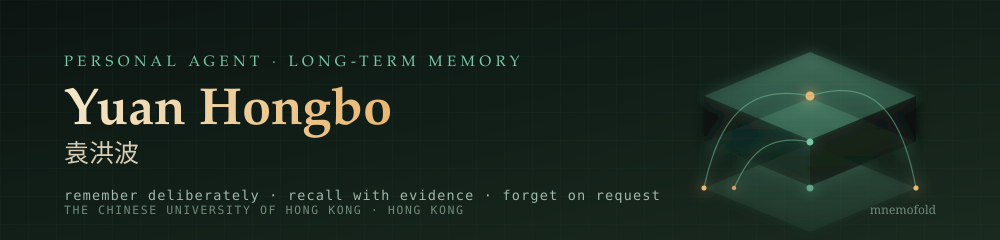
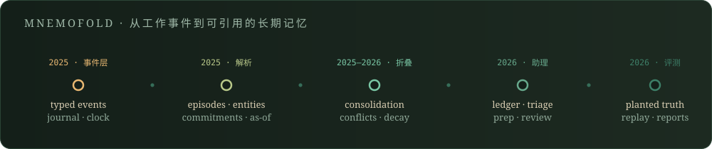

<div align="center">
  
</div>

<br/>

<div align="center">

`Python 3.11+` · `NumPy core` · `offline by default` · `as-of queries` · `cited context`

</div>

---

### 我在做什么

我在香港中文大学读书，关心 **Personal Agent 的长期记忆**，以及它如何真正落在一个每天都要用的工作助理上。比“记住更多”更难的是：

- 一段邮件线程、一次会议、一份文档，怎样被拆成**可追溯的片段与事实**；
- 谁答应了谁、什么时候到期、后来有没有改口——承诺的**状态与证据**如何保存；
- 截止日期改了、负责人换了，系统怎样知道旧版本在某个日期之前仍然是对的（**as-of 查询**）；
- 夜里把零散事件“折叠”成稳定记忆时，去重、合并、冲突消解如何保持**确定性与可回滚**；
- 晨报、会议准备、周回顾里出现的每一条结论，能否**引用**到具体记忆而不是凭空生成。

我把“能记、能查、能忘”当作同一个工程问题：记忆是有生命周期的，删除和遗忘必须是一等公民。

<div align="center">
  
</div>

### 当前项目 · mnemofold

> 离线优先的长期记忆框架 + 工作助理工具链。

| 层 | 内容 |
| --- | --- |
| 事件层 | 十类工作事件（邮件、会议、笔记、任务、文档、聊天、承诺确认等）的版本化模型、内容寻址 ID、带校验和的 JSONL 与 SQLite 追加日志 |
| 解析层 | 线程/会议/日片段切分、实体别名消解、承诺与决策抽取、文档引用链接、工作日历与跨时区截止计算 |
| 记忆层 | 人物/组织/项目/会议/文档/承诺/决策的工作流图；区间有效事实与 as-of 查询；工作集、情节、语义、流程四层记忆 |
| 折叠层 | 夜间巩固：片段 → 语义事实；重复流程 → playbook 候选；证据排序的冲突消解与取代；衰减、置顶与归档 |
| 检索层 | BM25 + 图谱扩展 + 时间过滤 + 重要度/新近度融合；MMR 去重；预算约束下的任务化上下文包（背包 DP 精确解） |
| 助理层 | 承诺台账、收件箱分诊（带理由）、会议准备包、日报/周报，全部支持引用回溯，HTML/SVG 自包含输出 |
| 执行层 | 工具注册表、计划 DSL、策略引擎、审批队列、幂等执行与审计回执 |
| 保障层 | 隐私分级与 PII 脱敏、删除级联与墓碑、字节级确定性回放、合成 180 天工作史与植入式评测 |

- 运行时只依赖 NumPy；`torch` 是可选 CPU extra，用于可训练的打分/融合演示。
- 每个提交都经过构建、测试与格式检查，验证回执按 tree 哈希保存在 `.git/validation/`。
- 评测数据全部来自合成工作史：植入的承诺、截止日期、矛盾与噪声都有 ground truth，指标可复现。

### 几条工作原则

1. **记忆需要证据。** 没有 provenance 的条目只是缓存，不能拿来解释。
2. **时间是一等维度。** “现在正确”与“当时正确”是两件事，系统要能同时回答。
3. **折叠必须幂等。** 同样的输入重复巩固，结果应当逐字节一致。
4. **遗忘是功能。** 删除要穿透索引、投影与派生记录，墓碑阻止复活。
5. **先离线跑通，再谈增强。** 网络与模型是可选项，不是前提。

### 工具与习惯

```text
语言      Python (3.11 / 3.12 / 3.13) · Shell
测试      pytest · 性质与边界测试 · 合成工作史评测
质量      ruff · mypy · 逐提交钩子校验
数据      SQLite · NumPy · 可选 PyTorch (CPU)
形态      CLI + 可嵌入库 + 静态报告
```

<br/>

<div align="center">
  <picture>
    <source media="(prefers-color-scheme: dark)" srcset="https://raw.githubusercontent.com/hklittlecoder/hklittlecoder/output/snake.svg"/>
    <source media="(prefers-color-scheme: light)" srcset="https://raw.githubusercontent.com/hklittlecoder/hklittlecoder/output/snake-light.svg"/>
    
  </picture>
</div>

<br/>

<div align="center">

**Yuan Hongbo** · 袁洪波 · The Chinese University of Hong Kong

`hklittlecoder` · Hong Kong

<sub>Remember deliberately. Recall with evidence. Forget on request.</sub>

</div>
